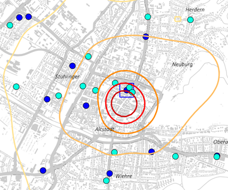

# Handbook of Market Area and Accessibility Models in the huff Python Package

**Author:** Thomas Wieland  
**ORCID:** [0000-0001-5168-9846](https://orcid.org/0000-0001-5168-9846)  
**EMail:** [geowieland@googlemail.com](geowieland@googlemail.com)  
**Version:** 1.2.3 · 2026-11-17

This handbook aims to provide an overview of the market area models and approaches to modeling spatial accessibility in my [**huff** Python package](https://github.com/geowieland/huff_official/). However, it is NOT intended as a documentation of the functions. For a quick start, see the package's [README](https://github.com/geowieland/huff_official/blob/main/README.md). Detailed examples of how to use the package functionalities can be found in the [examples folder in my public GitHub repository](https://github.com/geowieland/huff_official/tree/main/examples).

If you use this handbook, please cite:

Wieland T (2026) Handbook of Market Area and Accessibility Models in the `huff` Python Package. [https://geowieland.github.io/huff_official/](https://geowieland.github.io/huff_official/)

